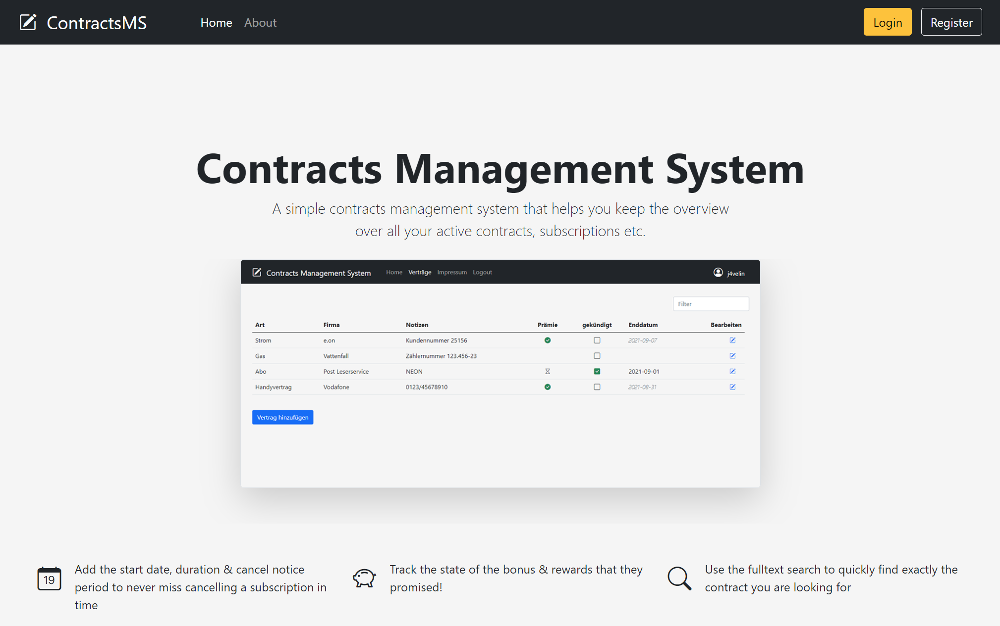

# Contracts Management System
Spring Boot webapp to manage contracs, subscriptions etc.



## Run with Docker

Starts the app together with a MongoDB database (data is kept in the `mongo-data` volume). For every version tag
(e.g. `1.2.0`), CI publishes a ready-built image to `ghcr.io/j4velin/contractsmanagementsystem`, so a server only
needs to download it:

```bash
cp .env.example .env   # then set REMEMBER_ME_KEY, e.g. to the output of: openssl rand -hex 32
docker compose pull && docker compose up -d
```

The same two commands (after a `git pull`, which keeps the compose file up to date) update to the latest released
version. To release a version, tag a commit on `main` and push the tag; the image is published once the tests and
the smoke test passed for it:

```bash
git tag 1.2.0 && git push origin 1.2.0
```
The tag is also the version shown in the footer of the app, so there is no version number to update by hand. Builds
without a release tag show the output of `git describe` (e.g. `1.2.0-3-gabc1234`), or `dev` for images built from a
checkout.

To build the image from the checkout instead, e.g. for local changes, use `docker compose up -d --build`.

The app is then available at http://localhost:8080 (change the port with `APP_PORT` in `.env`). Behind a reverse
proxy on the same server, use `APP_PORT=127.0.0.1:8081`, so the app is only reachable through the proxy: Docker opens
published ports past host firewalls like ufw.
The default memory limits (`APP_MAX_HEAP`, `MONGO_CACHE_GB`) suit a server with 2 GB of RAM.
Dates such as the cancel-by date are based on today's date in the `Europe/Berlin` time zone (change it with `TIMEZONE` in `.env`).
The database isn't reachable from outside the compose network.

`scripts/smoke-test.sh` runs an end-to-end check (registration, login, contracts, logout) against a running instance:

```bash
scripts/smoke-test.sh http://localhost:8080
```

## Run without Docker

Requires Java 21. Copy `src/main/resources/application.properties.sample` to `application.properties`, set the MongoDB URI, then:

```bash
./gradlew bootRun
```

## Run in an LXC container (without Docker)

`scripts/setup-lxc.sh` installs the app natively in a Debian 12 container (e.g. a Proxmox LXC): Java 21, MongoDB 8.0
(only reachable from inside the container) and a systemd service `contracts`. Run it as root from a clone of this
repository inside the container:

```bash
APP_PORT=8080 TIMEZONE=Europe/Berlin scripts/setup-lxc.sh
```

The settings end up in `/etc/contracts/contracts.env`, together with a generated remember-me key. To update the app,
run `git pull && scripts/setup-lxc.sh` again; the settings are kept. MongoDB needs a CPU with AVX.
